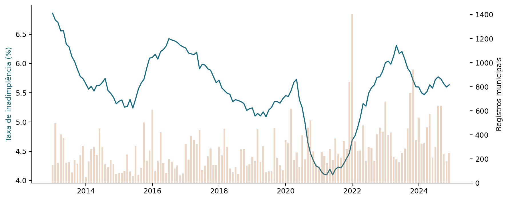

# Mudanças climáticas e inadimplência
### Uma análise da relação temporal de desastres naturais no sistema de crédito brasileiro

**Isabella Viana Bambirra** · Bacharelado em Estatística · Universidade Federal de São Carlos (UFSCar)

**Orientadora:** Profa. Daiane Aparecida Zuanetti

Este repositório reúne o painel agregado, os códigos, os notebooks e os resultados da análise empírica do Trabalho de Conclusão de Curso. O estudo investiga como os registros de desastres naturais se relacionam, ao longo do tempo, com a inadimplência no crédito a pessoas físicas no Brasil.

A investigação acompanha as 27 unidades da federação entre janeiro de 2013 e dezembro de 2024 e utiliza três abordagens complementares: testes de causalidade de Granger, modelos de defasagens distribuídas em painel (DLM) e comparação preditiva entre SARIMA e SARIMAX.

## Por onde começar

| Para conhecer… | Consulte |
| --- | --- |
| A sequência completa da análise | [Os cinco notebooks principais](notebooks/README.md) |
| As fontes, os filtros e a construção da taxa | [Descrição dos dados](data/README.md) |
| As especificações e os critérios de estimação | [Metodologia e sensibilidades](docs/metodologia_e_sensibilidades.md) |
| Os resultados e sua interpretação | [Síntese dos resultados](docs/resultados.md) |
| Os arquivos de cada etapa | [Índice das tabelas e figuras](outputs/README.md) |
| Como executar o projeto | [Guia de reprodução](docs/reproducao.md) |

Os notebooks podem ser lidos no próprio GitHub, com as saídas já salvas. Os arquivos necessários para conferir as análises estão identificados nos índices acima.

## Dados e recorte

O painel integra o **Sistema de Informações de Crédito do Banco Central do Brasil (SCR/BACEN)** e o **Atlas Digital de Desastres no Brasil**, com uma observação por UF e mês: **3.888 observações**, correspondentes a **27 UFs e 144 meses**.

No SCR, foram selecionadas operações de pessoas físicas e excluídas as modalidades **financiamentos imobiliários**, **financiamentos de títulos e valores mobiliários** e **outros créditos**. A filtragem ocorre antes da soma dos saldos ativos e inadimplentes. Dessa forma, o numerador e o denominador da taxa se referem ao mesmo conjunto de operações:

```text
Taxa de inadimplência (%) = 100 × saldo da carteira inadimplente / saldo da carteira ativa
```

As taxas do Brasil e das regiões são calculadas a partir dos respectivos saldos agregados. O Atlas reúne **40.339 registros municipais** no período, distribuídos em 16 tipologias e quatro grupos. No DLM, a exposição denominada **total climático** considera apenas os prefixos 12, 13 e 14 da COBRADE e soma **37.643 registros**. Um desastre que atingiu mais de um município pode gerar vários registros.

A análise considera o **recorte pré-pandemia, de janeiro de 2013 a janeiro de 2020**, e o **período completo, de janeiro de 2013 a dezembro de 2024**. Essa escolha permite comparar os resultados ao incluir os anos da pandemia e posteriores, marcados por mudanças na renda, no crédito e nas condições de renegociação. Os recortes compartilham observações.

## Sequência da investigação

1. **Análise descritiva:** distribuição dos registros de desastres e evolução da inadimplência no tempo, nas regiões e nas UFs.
2. **Estacionariedade:** avaliação das séries transformadas com os testes ADF e KPSS.
3. **Granger:** investigação da informação preditiva acrescentada pelas defasagens dos registros de desastres ao histórico da inadimplência.
4. **DLM:** estimação de associações ao longo das defasagens, com efeitos fixos de UF e de mês-ano.
5. **SARIMA/SARIMAX:** avaliação do desempenho de modelos com e sem exposições a desastres, em meses reservados para teste.



## Principais resultados

| Abordagem | Resultado |
| --- | --- |
| Granger | 627 das 864 aplicações planejadas foram estimáveis. Após o ajuste de Benjamini–Hochberg por UF e recorte, permaneceram 16 rejeições. |
| DLM | Na grade de 0 a K, cinco contrastes acumulados permaneceram significativos na banda de referência, correspondentes a três combinações de tipologia e recorte. Na grade de 3 a K, não houve rejeições após os ajustes nas bandas examinadas. |
| SARIMAX individual | Entre 452 aplicações estimáveis por grade, cinco na grade de 0 a K e seis na grade de 3 a K melhoraram simultaneamente o BIC e o RMSE em relação ao SARIMA. |
| SARIMAX geral | Um modelo, no Maranhão pré-pandemia e na grade de 3 a K, melhorou os dois critérios. |

Os resultados identificam associações temporais e contribuições preditivas em contextos específicos. As abordagens respondem a perguntas distintas e não identificam, por si, efeitos causais. Os [resultados detalhados](docs/resultados.md) apresentam as famílias de testes, os diagnósticos e as análises de sensibilidade necessários à interpretação.

## Organização do repositório

```text
data/         Fontes, estrutura das variáveis e painel agregado
notebooks/    Cinco cadernos principais na ordem da investigação
src/          Preparação dos dados, estimação e validação
outputs/      Tabelas, figuras e registros de integridade
docs/         Metodologia, resultados e instruções de reprodução
tcc/          Trechos de referência metodológica em LaTeX
```

O [painel publicado](data/processed/df_tcc_2013_2024.csv) e os resultados da versão final estão identificados no [índice de saídas](outputs/README.md). Os arquivos brutos devem ser obtidos nas fontes institucionais. Para executar a análise, use **Python 3.10.20** e as dependências de [requirements-reestimacao-exclusoes.lock.txt](requirements-reestimacao-exclusoes.lock.txt), seguindo o [guia de reprodução](docs/reproducao.md).

O [histórico de desenvolvimento](docs/historico.md) está preservado e identificado separadamente. O roteiro de leitura acima aponta para a documentação e as análises utilizadas na versão final do trabalho.
